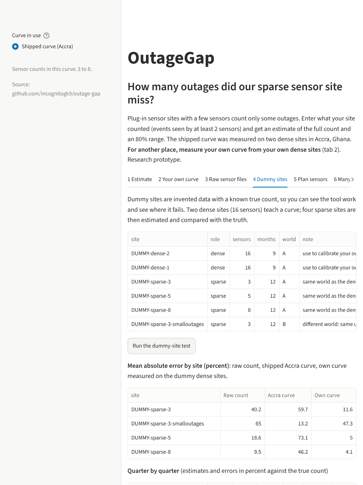

# OutageGap

**How many power outages did our sparse sensor site miss?**

OutageGap takes the number of outages a small plug-in sensor site counted (3 to 8 sensors) and returns an estimate of the full count, the number missed, and an 80% range. It ships a curve measured in Accra, Ghana, **and it lets you measure your own curve from your own dense sites**, so it can be used in other places. It is the working tool of the paper *Detection-Curve Correction of Missed-Outage Counts at Sparse Plug-In Sensor Sites: Subsampling Evaluation on Dense Sites* (MIPRO 2027).

> **Research prototype.** The shipped curve was measured on two dense sites in Accra, Ghana. Not a utility record. Read [Limits](#limits) before you use a number from it.




- **Live app:** https://outage-gap.streamlit.app (free Streamlit Community Cloud; it may need a click to wake up after a quiet period)
- **Code:** https://github.com/incognitogk9/outage-gap

## Contents
[Why](#why-this-exists) · [The idea](#the-idea-in-one-minute) · [Result](#what-it-does) · [Quick start](#quick-start) · [Your own curve](#measure-your-own-curve) · [Dummy sites](#dummy-sites-try-everything-without-real-data) · [API reference](#api-reference) · [Command line](#command-line) · [Counting events](#how-to-count-events-so-the-numbers-match) · [Limits](#limits) · [Reproduce](#reproduce-the-numbers) · [Deploy](#deploy-the-app-free-streamlit-community-cloud) · [Layout](#project-layout) · [Licence](#data-and-licence) · [Cite](#cite)

## Why this exists

Plug-in voltage sensors measure outages where utilities do not. The PowerWatch design puts three sensors at each site and counts an outage only when at least two sensors report it. That rule misses outages. On two dense Accra sites (15 to 23 sensors each), a site that keeps only 3 of the sensors and applies the same rule counts about **37%** of the outages that two or more of the full site's sensors saw. With 5 sensors it counts **47%**, with 8 sensors **62%**. These shares are measured against the dense site, not against the true number of outages, so the real miss rate is higher. Any outage count or SAIFI figure taken from a three-sensor site is far too low unless it is corrected.

## The idea in one minute

1. A **dense site** has many sensors (8 to 20). Almost every outage is seen by some of them, so its count of events seen by 2 or more sensors is a good reference.
2. Take random small groups of sensors from the dense site (3, 4, 5 ... 8), count events from each group alone with the PowerWatch rule, and compare with the full site. The share counted is the **detection curve**: it tells you how much a site of that size misses.
3. At a **sparse site** (3 to 8 sensors), divide the count by the share. That is the estimated total, with a range.

The curve depends on the place (outage sizes, sensor uptime, how sensors are spread). So there are two ways to use this repository:

| | Curve | Use when |
|---|---|---|
| **Shipped curve** | measured on two dense Accra sites | you work with Accra-like sites, or want a first idea |
| **Your own curve** | measured by you from your dense sites with `calibrate` | any other city or country; this is the way the method is meant to be used |

## What it does

**Estimated total = counted events ÷ detection share.** The shipped detection share comes from drawing random subsets of 3 to 8 sensors from the two dense sites (86 site-months, January 2021 to July 2024), rebuilding the outage events from only the subset's own readings, keeping events seen by at least 2 of its sensors, and comparing the count with the full site.

| Sensors | Detection share | Same, events fixed at full site / counted by 1+ sensor (not PowerWatch) | Median single-month error, raw count | Median single-month error, corrected (curve from the other site) | 80% range, times the estimate |
|---|---|---|---|---|---|
| 3 | 0.37 | 0.34 / 0.61 | 67% | 44% | 0.54 to 3.35 |
| 4 | 0.43 | 0.39 / 0.68 | 61% | 40% | 0.54 to 3.02 |
| 5 | 0.47 | 0.44 / 0.74 | 56% | 35% | 0.57 to 2.58 |
| 6 | 0.52 | 0.48 / 0.79 | 50% | 32% | 0.60 to 2.51 |
| 7 | 0.57 | 0.54 / 0.83 | 44% | 29% | 0.63 to 2.17 |
| 8 | 0.62 | 0.58 / 0.87 | 38% | 27% | 0.65 to 2.03 |

Reading the table: with 3 sensors, a site that counted 24 events gets an estimated total of 64 (range 35 to 215), about 40 missed. The range is wide on purpose. It is the 10th to 90th percentile of the error made when the share learned at one dense site is applied to the other, so it includes the difference between the two sites (shares 0.42 and 0.32 at 3 sensors). Single months are noisy; report quarters or years.

Capture-recapture (Chao2) needs the events seen by only one sensor, which the 2-sensor rule throws away, so it cannot run on data counted by the PowerWatch rule. Where single-sensor events are kept, it overestimates by about 25% at five or eight sensors. See the paper.

## Quick start

You need Python 3.10 or later.

```bash
git clone https://github.com/incognitogk9/outage-gap.git
cd outage-gap
pip install -r requirements.txt            # the app and the command line
streamlit run streamlit_app.py             # opens http://localhost:8501
```

Five ways to use it, from simplest to most flexible:

### 1. The web app (no code)

Six tabs: **Estimate** one site; **Your own curve** (upload dense sites); **Raw sensor files** (upload sparse sites, get the answer); **Dummy sites** (a test with known truth); **Plan sensors**; **Many sites (CSV)**. The sidebar chooses the curve every tab uses: the shipped Accra curve or one you measured.

### 2. Python

```python
from outage_gap.core import estimate
r = estimate(sensors=3, observed_events=24, uptime=0.8)
print(r.estimated_total, r.estimated_missed, r.range_80)   # 64.1 40.1 [34.5, 214.6]
```

With your own curve (see [Measure your own curve](#measure-your-own-curve)):

```python
import pandas as pd
from outage_gap.calibrate import calibrate
from outage_gap.core import estimate

my_curve = calibrate(pd.read_csv("dense_sites.csv"))        # slow step, once
r = estimate(3, 24, uptime=0.8, cal=my_curve)
```

### 3. Command line (works offline)

```bash
python -m outage_gap calibrate dense_sites.csv -o my_curve.json         # measure your curve
python -m outage_gap analyze sparse_sites.csv --curve my_curve.json     # raw file in, estimates out
python -m outage_gap estimate examples_sites.csv                         # counts you already have
```

All commands are listed in [Command line](#command-line).

### 4. Web API

```bash
pip install -r requirements-api.txt
uvicorn api.main:app --port 8000           # demo page at /, interactive docs at /docs
```

```bash
curl -X POST localhost:8000/estimate -H 'content-type: application/json' \
     -d '{"sensors":3,"observed_events":24,"uptime":0.8}'
```

Example reply (shortened):

```json
{"sensors":3,"observed_events":24,"detection_share":0.3745,"estimated_total":64.1,
 "estimated_missed":40.1,"range_80":[34.5,214.6],"interpolated":false,
 "curve":"Accra dense sites 3 and 4 (shipped curve)",
 "warnings":["Estimate for Accra-like sites, calibrated on two dense sites in Accra only; not a utility record."]}
```

Or with Docker: `docker build -t outage-gap . && docker run -p 8000:8000 outage-gap`.

### 5. Try it on dummy sites first

No real data needed. See [Dummy sites](#dummy-sites-try-everything-without-real-data).

## Measure your own curve

This is the step that makes the method usable outside Accra.

**What you need.** A raw sensor file of one or more **dense** sites: sites with at least 8 sensors (more is better). At least 6 site-months are needed, 24 or more is better, and two or more sites give a more honest range. Columns, either layout:

- nLine GridWatch 30-minute bins: `device, bin, n_obs, n_unpowered`
- raw readings: `device, time, on_battery` (1 if the sensor reported loss of mains power, else 0)
- optional `site` (or `site_id`) column to name sites. Without it all rows are one site.

**Step 1: measure.**

```bash
python -m outage_gap calibrate dense_sites.csv -o my_curve.json
```

Options: `--sizes 3,4,5,6,7,8` (sensor counts to measure), `--draws 40` (random groups per site-month and size), `--min-sensors 8` (a dense site-month needs this many sensors), `--min-coverage 0.6` (each reporting in this share of 30-minute bins), `--seed 1`. The command prints the detection share for each sensor count and any notes. A file the size of the Accra data (2.5 million rows) takes about one minute.

**Step 2: use it.** Any of these:

```bash
python -m outage_gap estimate sites.csv --curve my_curve.json          # counts already known
python -m outage_gap analyze sparse_sites.csv --curve my_curve.json    # raw sensor file in, estimates out
python -m outage_gap plan --target 0.8 --curve my_curve.json           # sensors needed
```

or in Python `estimate(..., cal=my_curve)`, or in the API (below), or in the web app (tab 2 measures it, tab 3 uses it).

**What the curve file holds.** For each measured sensor count: the detection share `c`, the 10th and 90th percentile of the error (`err_q10`, `err_q90`) that makes the 80% range, and the median single-month error. It also records the reference uptime, the number of site-months and sites, how the range was made, and warnings. Every estimate made with it prints the curve's source and passes these warnings on.

**How the range is made.** With two or more dense sites: the share learned at the other sites is applied to each site, so the range includes the difference between sites. With one site: the share from the earlier half of the months is applied to the later half and the reverse, so the range is probably too narrow for a different place. The result says which was used (`range_method`).

**Check.** On the real Accra rows this function gives exactly the shipped curve (`reproduce/check_own_curve_function.py`; a test does the same from the shipped draws).

## Dummy sites: try everything without real data

The repository can generate invented sites with a **known true outage count**, so you can see every step work and see where it fails. Nothing in them is a measurement of a real place.

| Site | Sensors | What it is |
|---|---|---|
| `DUMMY-dense-1`, `DUMMY-dense-2` | 16 | dense sites in world A (9 months each): teach your own curve |
| `DUMMY-sparse-3`, `-5`, `-8` | 3, 5, 8 | sparse sites in the same world A (12 months): the own curve should work |
| `DUMMY-sparse-3-smalloutages` | 3 | sparse site in a different world: same uptime, but most outages reach only one or two sensors. The own curve is wrong here and **no warning appears** |

```bash
python -m outage_gap demo --out dummy/     # writes dense.csv, sparse.csv, dummy_curve.json and prints the test
```

Result of that test (mean absolute error over four quarters, against the true count; fixed random seeds, so you get the same numbers):

| Site | Raw count | Shipped Accra curve | Own curve (from the dummy dense sites) |
|---|---|---|---|
| sparse, 3 sensors | 40% | 60% | **12%** |
| sparse, 5 sensors | 19% | 73% | **5%** |
| sparse, 8 sensors | 10% | 46% | **4%** |
| sparse, 3 sensors, small outages | 65% | 13% | 47% |

How to read it. The dummy world detects more outages than Accra does, so the Accra curve over-corrects there. The curve measured on the dummy dense sites works in its own world. In the different world it fails, and the Accra curve looks good only by chance (its mistakes happen to cancel). That is the point of measuring a curve near the sites you care about. The dummy world has no differences between its two dense sites, so its ranges are narrower than real ones.

The same test runs in the web app (tab 4, and the page at `/`) and in the API (`GET /demo/run`). The dummy files can be fed to every command: `calibrate` takes `dense.csv`, `analyze` takes `sparse.csv`.

## API reference

Start the service with `uvicorn api.main:app --port 8000`. Interactive documentation with a form for every route is at `/docs`. All routes accept and return JSON unless noted. Errors return a clear message (`detail`) with HTTP 422 (bad input), 404 (unknown id or site) or 413 (file over 60 MB).

| Route | Method | Purpose |
|---|---|---|
| `/estimate` | POST | one site: counted events and sensor count in, estimate out |
| `/estimate/batch` | POST | many sites in one JSON call; a bad row gets an `error` entry, the others are still answered |
| `/estimate/csv` | POST (file) | many sites from a CSV file; answer is a CSV file |
| `/count` | POST (file) | raw sensor file in; events seen by 2+ sensors per site and period out |
| `/analyze` | POST (file) | raw sensor file in; counts **and** estimates per site and period out |
| `/calibrate` | POST (file) | dense-site file in; your own curve and a `calibration_id` out |
| `/calibrations/{id}` | GET | fetch a stored curve |
| `/curve` | GET | the shipped curve, or `?calibration_id=` another |
| `/plan` | GET | sensors needed for a target share: `?target_share=0.8` |
| `/demo/sites` | GET | list of dummy sites |
| `/demo/sites/{site}.csv`, `/demo/dense.csv`, `/demo/sparse.csv` | GET | dummy sensor files to download and upload |
| `/demo/run` | GET | whole pipeline on the dummy sites against the known truth |
| `/health` | GET | status, version, sensor counts of the shipped curve |
| `/` | GET | demo page with every function; `/docs` is the interactive reference |

**Which curve.** Every estimating route takes `calibration_id`: leave it out for the shipped Accra curve, use `demo` for the dummy-site curve, or use the id returned by `/calibrate`. Calibrations are kept **in memory only** (50 most recent; lost when the service restarts). To be independent of that, send the whole curve in the `calibration` field of `/estimate` and `/estimate/batch`; it overrides the id.

### Worked example: from raw files to an answer

```bash
# 1. look at the dummy sites
curl localhost:8000/demo/sites

# 2. download the dense dummy file and measure a curve from it (about 5 seconds)
curl -o dense.csv localhost:8000/demo/dense.csv
curl -F file=@dense.csv -F draws=20 localhost:8000/calibrate
#   -> {"calibration_id":"c_ab9404acd1", "summary":[{"sensors":3,"detection_share":0.6631,...}], "calibration":{...}, "warnings":[...]}

# 3. estimate one site with that curve
curl -X POST localhost:8000/estimate -H 'content-type: application/json' \
     -d '{"sensors":3,"observed_events":24,"uptime":0.9,"calibration_id":"c_ab9404acd1"}'

# 4. or go from a raw sparse file straight to estimates, per quarter
curl -o sparse.csv localhost:8000/demo/sparse.csv
curl -F file=@sparse.csv -F period=quarter -F calibration_id=c_ab9404acd1 localhost:8000/analyze

# 5. compare with the known truth
curl localhost:8000/demo/run

# 6. how many sensors for a site to count 80% of the reference outages?
curl 'localhost:8000/plan?target_share=0.8&calibration_id=c_ab9404acd1'
```

In Python with `requests`:

```python
import requests
base = "http://localhost:8000"
cal = requests.post(f"{base}/calibrate", files={"file": open("dense.csv", "rb")}, data={"draws": 20}).json()
r = requests.post(f"{base}/estimate", json={"sensors": 3, "observed_events": 24, "calibration": cal["calibration"]}).json()
print(r["estimated_total"], r["range_80"])      # 36.2 [30.7, 44.4]
```

### Fields of `/estimate`

| Field | Direction | Meaning |
|---|---|---|
| `sensors` | in | sensors at the site, a whole number inside the curve's range (3 to 8 for the shipped curve; others are refused with HTTP 422) |
| `observed_events` | in | events counted by 2 or more of the site's sensors in the period, 0 or more |
| `uptime` | in, optional | share of time the sensors reported, 0 to 1. A warning only, **not** part of the estimate |
| `calibration_id` / `calibration` | in, optional | which curve (see above) |
| `detection_share` | out | share of outages a site of this size counts, from the curve |
| `estimated_total`, `estimated_missed` | out | counted ÷ share, and the difference |
| `range_80` | out | 10th to 90th percentile range |
| `interpolated` | out | true if the sensor count lies between measured sizes (own curves with gaps) |
| `curve` | out | the name and source of the curve used |
| `warnings` | out | not a utility record; uptime missing or different from the reference; fewer than 10 events; notes of an own curve |

### Fields of `/calibrate` (form data)

`file` (CSV, required), `sizes` (default `3,4,5,6,7,8`), `draws` (default 40, at most 100), `seed` (1), `min_sensors` (8), `min_coverage` (0.6). Large files take minutes: use the command line for those.

### Fields of `/count` and `/analyze` (form data)

`file` (CSV, required), `period` (`quarter` default for `/analyze`; `all`, `month`, `quarter`, `year`), and for `/analyze` the optional `calibration_id`. Sensors and uptime are measured inside each period from the file, so a sensor that never reported in a period is not counted.

## Command line

```
python -m outage_gap estimate sites.csv [--curve my_curve.json]      columns: site,sensors,observed_events[,uptime]
python -m outage_gap count raw.csv [--period quarter]                events per site from a raw sensor file
python -m outage_gap analyze raw.csv [--period quarter] [--curve my_curve.json]   count, then estimate
python -m outage_gap calibrate dense.csv -o my_curve.json            measure your own curve from dense sites
python -m outage_gap plan --target 0.7 [--curve my_curve.json]       sensors needed for a target share
python -m outage_gap demo [--out folder]                             run on dummy sites (writes their CSV files)
python -m outage_gap sites.csv                                       short form of 'estimate'
```

Sites outside the curve's sensor range come back with an `ERROR` note. The tool does not guess.

## How to count events so the numbers match

The curve only holds if your count follows the same rule as ours. The script `outage_gap/count_events.py` applies it for you.

1. Use 30-minute bins per sensor. A sensor is **down** in a bin if at least half of its readings were on battery.
2. A **site event** is a run of bins with at least one sensor down, merged when 60 minutes or less apart.
3. **Keep only events seen by at least 2 sensors of the site.** This is the PowerWatch rule, and the rule the detection shares were measured under. If you count events seen by 1 or more sensors, do not use this tool: the shares would be 0.61 (3 sensors) to 0.87 (8 sensors).
4. Count per site and per period (a quarter works well; single months are noisy).

```bash
python -m outage_gap count readings.csv --period quarter     # all sites in one file, one row per site and period
python -m outage_gap.count_events readings.csv               # one site, one number
```

Input is either raw readings (`device,time,on_battery`, with `on_battery` 1 or 0) or nLine GridWatch bins (`device,bin,n_obs,n_unpowered`). It gives `events_2plus`, the number to enter. An optional `site` column splits a file into sites. `events_1_only` and `uptime_estimate` are printed for information.

The script was checked on the real nLine rows of the two dense sites: for all 86 site-months its count on the full set of sensors equals the reference count of the study. See `reproduce/end_to_end_check.py`.

## Limits

- Two dense sites in one city. **The curve did not transfer to Sierra Leone** in a preliminary check (`reproduce/second_region_check.py`): in the only 6 site-months there with 8 sensors (3 sites), 3 of the 8 sensors counted 79% of the events of the 8, against 60% in Accra under the same 8-sensor reference, so the Accra curve overestimated by about 35%. Recalibrate before using the tool in any other country. The sites differ: at 3 sensors the share is 0.42 at one and 0.32 at the other, and the cross-site mean error is about +28% and −23%.
- The reference count is the union of about 19 sensors, not a utility record, and it is not saturated: the share still rises from 0.81 at 12 sensors to 0.95 at 16. The real miss rate is higher than reported. Outages that no sensor saw cannot be checked on real data.
- **Low sensor uptime breaks the curve.** In simulation, a curve learned at uptime 0.8 underestimated the total by 12% (8 sensors) to 43% (3 sensors) at uptime 0.5, and an outage-size mix unlike Accra's gives errors of about 40% at 3 sensors. The estimate does **not** use uptime; the app only warns when uptime is below 0.65 or missing. We tested an uptime term on the real Accra data: subset uptime ran from 0.66 to 1.0 (median 0.95) and the term changed the median single-month error by between −2.3 and +2.2 points across six tests (3, 5 and 8 sensors, learned at one site and tested at the other; it helped in four and hurt in two), so it is not worth adding. Uptime near 0.5 has no real data, which is why it is a warning and not a correction.
- Single months are noisy: the median error is about 44% at three sensors even with the curve from the other dense site, against 67% for the raw count.
- The 80% range covered the full count in 71 to 81% of draws when each site was tested with the other site's curve, and in 74 to 77% across time. Treat it as a range that holds about three times in four.
- **Your own curve is only as good as your dense sites.** It is measured against the dense sites' own union of sensors, so it is an upper bound on the real share; if the share is still rising at your largest size, the real share is lower. One dense site gives a range that is probably too narrow (earlier versus later months, not different places). The curve warns when the site's uptime differs from the reference uptime by more than 0.15, but nothing in the counts can warn about a different outage-size mix (see the last dummy site). Measure the curve at dense sites near the sparse sites you want to correct.
- The `plan` route reports shares against the dense reference, so sensor counts it recommends are minimums.
- Duration indices (SAIDI) are not corrected. Only the count of outages is.
- Saved curves in the API live in memory only; keep the JSON file.
- The event rule (half of readings, 60-minute merge, 2 sensors) and the month filter are choices that were not varied.

## Using it in practice (regulators, utilities, researchers)

See [docs/REALISTIC_USE.md](docs/REALISTIC_USE.md): what a team needs, a step-by-step way to recalibrate for a new city, and what the tool cannot do.

## Reproduce the numbers

Everything in the paper comes from these steps. The subsampling draws are included, so steps 3 and 4 run without the raw data.

```bash
# 1. get the data: nLine GridWatch Accra (CC BY-NC 4.0) https://nline.io/public-data/gridwatch
pip install pyarrow pandas numpy
python3 -I reproduce/extract_sites.py path/to/ghana/*.parquet          # writes sites34.csv (sites 3 and 4)

# 2. subsample (seed 1, 40 draws per site-month and size; sizes 3-8, 12, 16) and write the draws (about 27,000 rows)
python3 -I reproduce/run_subsampling.py sites34.csv calibration/calibration_draws.csv

# 3. rebuild the detection curve used by the app
python3 -I calibration/build_calibration.py calibration/calibration_draws.csv outage_gap/calibration.json

# 4. check the shipped counting script and estimator on real rows
python3 reproduce/end_to_end_check.py sites34.csv calibration/calibration_draws.csv

# 5. check that the function that builds YOUR curve (python -m outage_gap calibrate) gives exactly the shipped curve
python3 reproduce/check_own_curve_function.py sites34.csv
```

Columns of `calibration_draws.csv`: `site, month, k, sensors_in_month, full` (reference count N), `obs2` (events of N seen by 2+ subset sensors, events fixed at the full site), `obs1` (seen by 1+), `chao` (Chao2 estimate from `obs1`), `full3` and `obs2_f3` (stricter reference of 3+ sensors), `obs_rb` (events rebuilt from the subset's own readings, 2+ sensors: **the column the app uses**).

Expected results (rounded): detection share 0.37 / 0.47 / 0.62 at 3 / 5 / 8 sensors; 86 site-months; median 39.5 events before and 23 after the 2-sensor filter. Re-running step 2 on the original data reproduces the included file exactly. Run `python -m pytest -q tests` for the tests (counting rule, curve, own-curve function, dummy sites, API routes, command line, Streamlit screen).

## Deploy the app (free, Streamlit Community Cloud)

1. Make sure the repository is on your GitHub account (public).
2. Go to https://share.streamlit.io and sign in with GitHub.
3. Choose **Create app**, pick this repository, branch `main`, main file `streamlit_app.py`.
4. Under advanced settings choose Python 3.11 or later, set the app address to `outage-gap` if it is free, and press **Deploy**.
5. Put the final address at the top of this README.

The FastAPI service in `api/` can run on any host that runs Python (a `Dockerfile` is included), for example a free tier of Render or Hugging Face Spaces.

## Project layout

```
streamlit_app.py        the app (Streamlit)
outage_gap/             core.py (curve, estimate, plan), calibrate.py (measure your own curve), count_events.py (counting rule),
                        demo.py (dummy sites), batch.py (CSV), __main__.py (command line), calibration.json (shipped Accra curve)
api/                    FastAPI service (main.py) and demo page (demo.html)
calibration/            the subsampling draws and the script that builds the curve
reproduce/              scripts that rebuild the draws from the raw nLine files, check the tool end to end, check the own-curve function, the Sierra Leone check and the uptime check
tests/                  core, own-curve function, dummy sites, API routes, command line, Streamlit screen
docs/                   screenshots, practical-use guide
```

## Data and licence

- Code: MIT licence (see `LICENSE`).
- The calibration is derived from the nLine GridWatch Accra dataset, licensed **CC BY-NC 4.0**. Attribution to nLine is required, and use of the derived calibration for commercial purposes needs a check against that licence.
- The method described here is the subject of a patent application in preparation; the MIT licence covers the code as published.

## Cite

See `CITATION.cff`. Paper: Z. Ombiro, "Detection-Curve Correction of Missed-Outage Counts at Sparse Plug-In Sensor Sites: Subsampling Evaluation on Dense Sites", MIPRO 2027 (submitted).

## Contact

Zablon Ombiro, Strathmore University, Nairobi, Kenya. zablon.ombiro@strathmore.edu

## Plain-English results

Every result in the app and the API comes with a short explanation for non-technical readers: what the numbers mean, how we got there, how sure you can be, and what to do next (`outage_gap/explain.py`; the API returns it in the `explanation` field).
