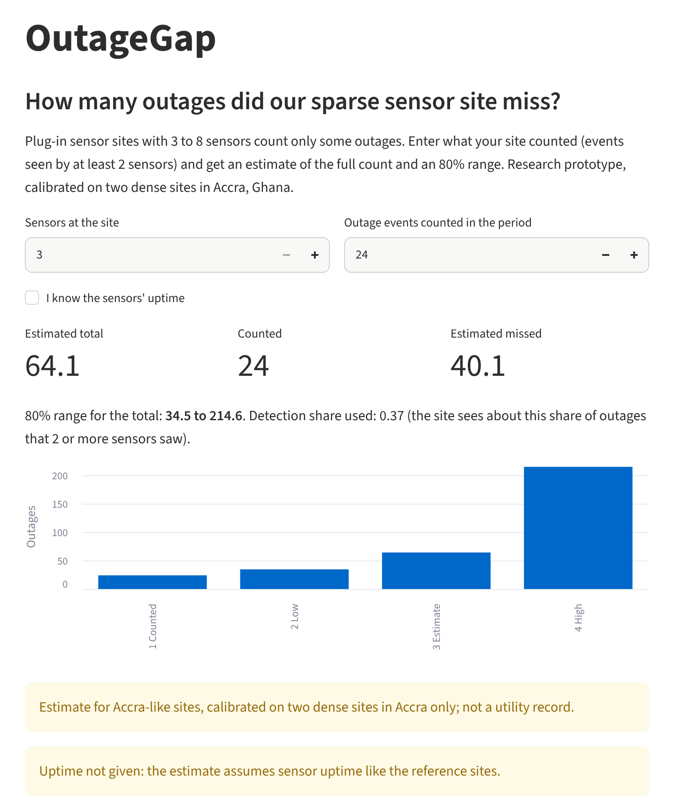

# OutageGap

**How many power outages did our sparse sensor site miss?**

OutageGap takes the number of outages a small plug-in sensor site counted (3 to 8 sensors) and returns an estimate of the full count, the number missed, and an 80% range. It is the working tool of the paper *Detection-Curve Correction of Missed-Outage Counts at Sparse Plug-In Sensor Sites: Subsampling Evaluation on Dense Sites* (MIPRO 2027).

> **Research prototype.** Calibrated on two dense sites in Accra, Ghana. Not a utility record. Read [Limits](#limits) before you use a number from it.



- **Live app:** https://outage-gap.streamlit.app (free Streamlit Community Cloud; it may need a click to wake up after a quiet period)
- **Code:** https://github.com/incognitogk9/outage-gap

## Contents
[Why](#why-this-exists) · [Result](#what-it-does) · [Quick start](#quick-start) · [API reference](#api-reference) · [Counting events](#how-to-count-events-so-the-numbers-match) · [Limits](#limits) · [Reproduce](#reproduce-the-numbers) · [Deploy](#deploy-the-app-free-streamlit-community-cloud) · [Layout](#project-layout) · [Licence](#data-and-licence) · [Cite](#cite)

## Why this exists

Plug-in voltage sensors measure outages where utilities do not. The PowerWatch design puts three sensors at each site and counts an outage only when at least two sensors report it. That rule misses outages. On two dense Accra sites (15 to 23 sensors each), a site that keeps only 3 of the sensors and applies the same rule counts about **37%** of the outages that two or more of the full site's sensors saw. With 5 sensors it counts **47%**, with 8 sensors **62%**. These shares are measured against the dense site, not against the true number of outages, so the real miss rate is higher. Any outage count or SAIFI figure taken from a three-sensor site is far too low unless it is corrected.

## What it does

**Estimated total = counted events ÷ detection share.** The detection share comes from drawing random subsets of 3 to 8 sensors from the two dense sites (86 site-months, January 2021 to July 2024), rebuilding the outage events from only the subset's own readings, keeping events seen by at least 2 of its sensors, and comparing the count with the full site.

| Sensors | Detection share | Same, events fixed at full site / counted by 1+ sensor (not PowerWatch) | Median single-month error, raw count | Median single-month error, corrected (curve from the other site) | 80% range, times the estimate |
|---|---|---|---|---|---|
| 3 | 0.37 | 0.34 / 0.61 | 67% | 44% | 0.54 to 3.35 |
| 4 | 0.43 | 0.39 / 0.68 | 61% | 40% | 0.54 to 3.02 |
| 5 | 0.47 | 0.44 / 0.74 | 56% | 35% | 0.57 to 2.58 |
| 6 | 0.52 | 0.48 / 0.79 | 50% | 32% | 0.60 to 2.51 |
| 7 | 0.57 | 0.54 / 0.83 | 44% | 29% | 0.63 to 2.17 |
| 8 | 0.62 | 0.58 / 0.87 | 38% | 27% | 0.65 to 2.03 |

Reading the table: with 3 sensors, a site that counted 24 events gets an estimated total of 64 (range 35 to 215), about 40 missed. The range is wide on purpose. It is the 10th to 90th percentile of the error made when the share learned at one dense site is applied to the other, so it includes the difference between the two sites (shares 0.42 and 0.32 at 3 sensors). Single months are noisy; report quarters or years.

Capture-recapture (Chao2) needs the events seen by only one sensor, which the 2-sensor rule throws away, so it cannot run on data counted by the PowerWatch rule. Where single-sensor events are kept, it overestimates by about 25% at five or eight sensors. See the paper.

## Quick start

You need Python 3.10 or later.

```bash
git clone https://github.com/incognitogk9/outage-gap.git
cd outage-gap
pip install -r requirements.txt            # the app
streamlit run streamlit_app.py             # opens http://localhost:8501
```

### 1. Use the web app (no code)

Enter the number of sensors, the number of events your site counted, and (if you know it) the sensors' uptime. The page shows the estimate, the range, and warnings. A CSV upload box handles many sites at once.

### 2. Use it from Python

```python
from outage_gap.core import estimate
r = estimate(sensors=3, observed_events=24, uptime=0.8)
print(r.estimated_total, r.estimated_missed, r.range_80)   # 64.1 40.1 [34.5, 214.6]
```

### 3. Use it for many sites (CSV, works offline)

Make a file with the columns `site,sensors,observed_events` and optionally `uptime` (see `examples_sites.csv`):

```bash
python -m outage_gap examples_sites.csv > estimates.csv
```

Sites outside 3 to 8 sensors come back with an `ERROR` note. The tool does not guess.

### 4. Use it as a web API

```bash
pip install -r requirements-api.txt
uvicorn api.main:app --port 8000           # demo page at /, interactive docs at /docs
```

```bash
curl -X POST localhost:8000/estimate -H 'content-type: application/json' \
     -d '{"sensors":3,"observed_events":24,"uptime":0.8}'
```

Example reply (shortened):

```json
{"sensors":3,"observed_events":24,"detection_share":0.3745,"estimated_total":64.1,
 "estimated_missed":40.1,"range_80":[34.5,214.6],"interpolated":false,
 "warnings":["Estimate for Accra-like sites, calibrated on two dense sites in Accra only; not a utility record."]}
```

Or with Docker: `docker build -t outage-gap . && docker run -p 8000:8000 outage-gap`.

## API reference

| Route | Method | Purpose |
|---|---|---|
| `/estimate` | POST | the estimate for one site |
| `/curve` | GET | the stored detection shares and error percentiles |
| `/health` | GET | returns `{"status":"ok"}` |
| `/` | GET | small demo page |
| `/docs` | GET | interactive documentation (FastAPI) |

| Field | Direction | Meaning |
|---|---|---|
| `sensors` | in | sensors at the site, whole number 3 to 8 (others are refused with HTTP 422) |
| `observed_events` | in | events counted by 2 or more of the site's sensors in the period, 0 or more |
| `uptime` | in, optional | share of time the sensors reported, 0 to 1. Used for a warning only, **not** in the estimate |
| `detection_share` | out | share of outages a site of this size counts, from the curve |
| `estimated_total`, `estimated_missed` | out | counted ÷ share, and the difference |
| `range_80` | out | 10th to 90th percentile range |
| `interpolated` | out | always false: every size from 3 to 8 was measured |
| `warnings` | out | not a utility record; low uptime (below 0.65); uptime missing; fewer than 10 events |

## How to count events so the numbers match

The curve only holds if your count follows the same rule as ours. The script `outage_gap/count_events.py` applies it for you.

1. Use 30-minute bins per sensor. A sensor is **down** in a bin if at least half of its readings were on battery.
2. A **site event** is a run of bins with at least one sensor down, merged when 60 minutes or less apart.
3. **Keep only events seen by at least 2 sensors of the site.** This is the PowerWatch rule, and the rule the detection shares were measured under. If you count events seen by 1 or more sensors, do not use this tool: the shares would be 0.61 (3 sensors) to 0.87 (8 sensors).
4. Count per site and per period (a quarter works well; single months are noisy).

```bash
python -m outage_gap.count_events readings.csv
```

Input is either raw readings (`device,time,on_battery`, with `on_battery` 1 or 0) or nLine GridWatch bins (`device,bin,n_obs,n_unpowered`). It prints `events_2plus`, the number to enter. `events_1_only` and `uptime_estimate` are printed for information.

The script was checked on the real nLine rows of the two dense sites: for all 86 site-months its count on the full set of sensors equals the reference count of the study. See `reproduce/end_to_end_check.py`.

## Limits

- Two dense sites in one city. **The curve did not transfer to Sierra Leone** in a preliminary check (`reproduce/second_region_check.py`): in the only 6 site-months there with 8 sensors (3 sites), 3 of the 8 sensors counted 79% of the events of the 8, against 60% in Accra under the same 8-sensor reference, so the Accra curve overestimated by about 35%. Recalibrate before using the tool in any other country. The sites differ: at 3 sensors the share is 0.42 at one and 0.32 at the other, and the cross-site mean error is about +28% and −23%.
- The reference count is the union of about 19 sensors, not a utility record, and it is not saturated: the share still rises from 0.81 at 12 sensors to 0.95 at 16. The real miss rate is higher than reported. Outages that no sensor saw cannot be checked on real data.
- **Low sensor uptime breaks the curve.** In simulation, a curve learned at uptime 0.8 underestimated the total by 12% (8 sensors) to 43% (3 sensors) at uptime 0.5, and an outage-size mix unlike Accra's gives errors of about 40% at 3 sensors. The estimate does **not** use uptime; the app only warns when uptime is below 0.65 or missing.
- Single months are noisy: the median error is about 44% at three sensors even with the curve from the other dense site, against 67% for the raw count.
- The 80% range covered the full count in 71 to 81% of draws when each site was tested with the other site's curve, and in 74 to 77% across time. Treat it as a range that holds about three times in four.
- Duration indices (SAIDI) are not corrected. Only the count of outages is.
- The event rule (half of readings, 60-minute merge, 2 sensors) and the month filter are choices that were not varied.

## Using it in practice (regulators, utilities, researchers)

See [docs/REALISTIC_USE.md](docs/REALISTIC_USE.md): what a team needs, a step-by-step way to recalibrate for a new city, and what the tool cannot do.

## Reproduce the numbers

Everything in the paper comes from these steps. The subsampling draws are included, so steps 3 and 4 run without the raw data.

```bash
# 1. get the data: nLine GridWatch Accra (CC BY-NC 4.0) https://nline.io/public-data/gridwatch
pip install pyarrow pandas numpy
python3 -I reproduce/extract_sites.py path/to/ghana/*.parquet          # writes sites34.csv (sites 3 and 4)

# 2. subsample (seed 1, 40 draws per site-month and size; sizes 3-8, 12, 16) and write the draws (about 27,000 rows)
python3 -I reproduce/run_subsampling.py sites34.csv calibration/calibration_draws.csv

# 3. rebuild the detection curve used by the app
python3 -I calibration/build_calibration.py calibration/calibration_draws.csv outage_gap/calibration.json

# 4. check the shipped counting script and estimator on real rows
python3 reproduce/end_to_end_check.py sites34.csv calibration/calibration_draws.csv
```

Columns of `calibration_draws.csv`: `site, month, k, sensors_in_month, full` (reference count N), `obs2` (events of N seen by 2+ subset sensors, events fixed at the full site), `obs1` (seen by 1+), `chao` (Chao2 estimate from `obs1`), `full3` and `obs2_f3` (stricter reference of 3+ sensors), `obs_rb` (events rebuilt from the subset's own readings, 2+ sensors: **the column the app uses**).

Expected results (rounded): detection share 0.37 / 0.47 / 0.62 at 3 / 5 / 8 sensors; 86 site-months; median 39.5 events before and 23 after the 2-sensor filter. Re-running step 2 on the original data reproduces the included file exactly. Run `python -m pytest -q tests` for the 14 tests.

## Deploy the app (free, Streamlit Community Cloud)

1. Make sure the repository is on your GitHub account (public).
2. Go to https://share.streamlit.io and sign in with GitHub.
3. Choose **Create app**, pick this repository, branch `main`, main file `streamlit_app.py`.
4. Under advanced settings choose Python 3.11 or later, set the app address to `outage-gap` if it is free, and press **Deploy**.
5. Put the final address at the top of this README.

The FastAPI service in `api/` can run on any host that runs Python (a `Dockerfile` is included), for example a free tier of Render or Hugging Face Spaces.

## Project layout

```
streamlit_app.py        the app (Streamlit)
outage_gap/             core.py (curve and estimate), batch.py (CSV), count_events.py (counting rule), calibration.json
api/                    FastAPI service and demo page
calibration/            the subsampling draws and the script that builds the curve
reproduce/              scripts that rebuild the draws from the raw nLine files, check the tool end to end, and the Sierra Leone check
tests/                  14 tests (core, counting rule, calibration, batch, API routes, Streamlit screen)
docs/                   screenshots, practical-use guide
```

## Data and licence

- Code: MIT licence (see `LICENSE`).
- The calibration is derived from the nLine GridWatch Accra dataset, licensed **CC BY-NC 4.0**. Attribution to nLine is required, and use of the derived calibration for commercial purposes needs a check against that licence.
- The method described here is the subject of a patent application in preparation; the MIT licence covers the code as published.

## Cite

See `CITATION.cff`. Paper: Z. Ombiro, "Detection-Curve Correction of Missed-Outage Counts at Sparse Plug-In Sensor Sites: Subsampling Evaluation on Dense Sites", MIPRO 2027 (submitted).

## Contact

Zablon Ombiro, Strathmore University, Nairobi, Kenya. zablon.ombiro@strathmore.edu
